<p align="center">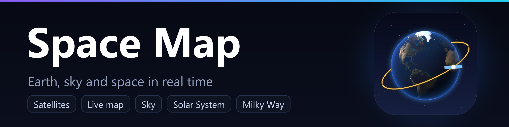</p>

[](https://opensource.org/licenses/MIT)
[](../../releases)
[](../../actions/workflows/build.yml)

### Earth

Satellites on a 3D globe: NASA imagery, drifting clouds, orbits, ground tracks and pass predictions, with full catalogue details for any object you click.

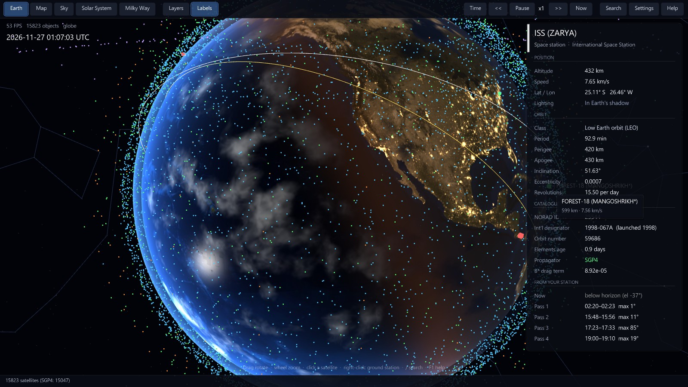

The night side glows with city lights.

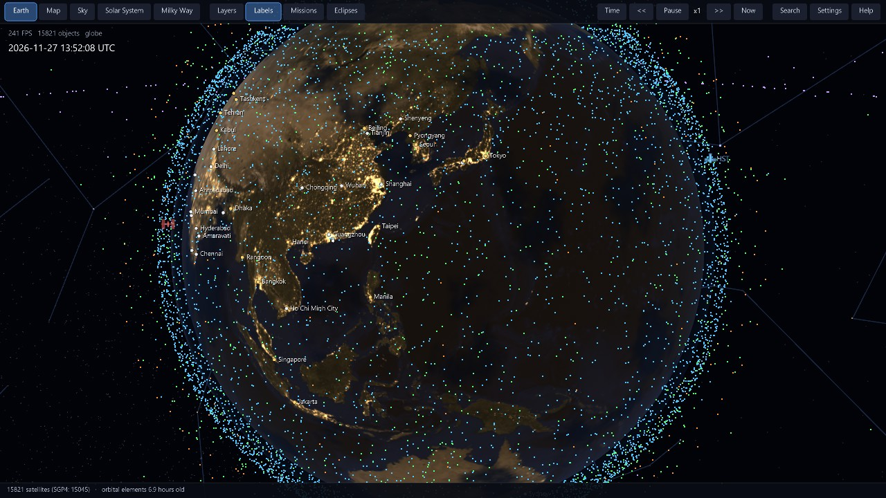

### Live Map

Zoom to street level with live aircraft, rain radar, cloud imagery, wind and local weather.

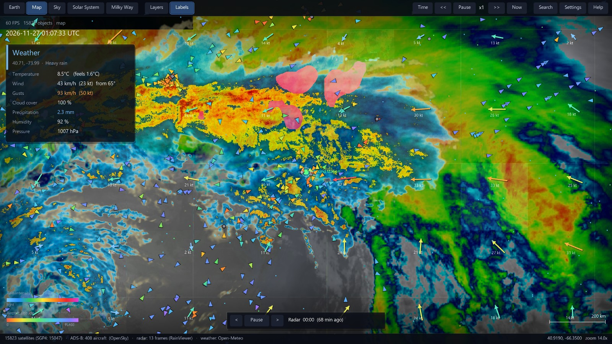

Live ship traffic (Baltic and Finnish waters) over a dark base map.


Aircraft and ships are drawn as type-specific silhouettes, oriented by heading.

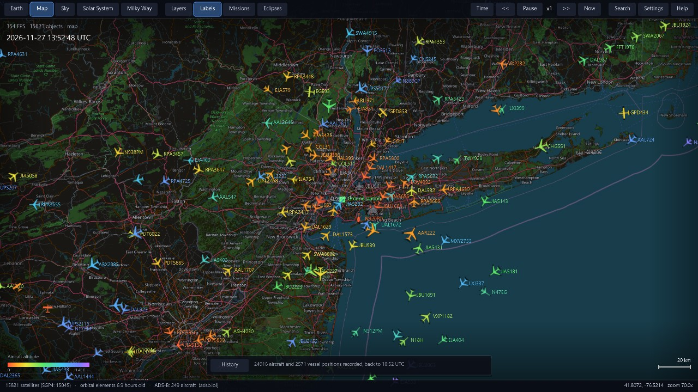

Switch layers, base maps and filters from the toolbar.


### Sky

The sky from your ground station: real stars, 88 constellations, planets, the Moon's phase and every satellite above your horizon, with a pass planner for the ISS, Tiangong and Hubble.


Messier deep-sky objects are marked, and the Eclipses list (`F9`) predicts the next solar and lunar eclipses.

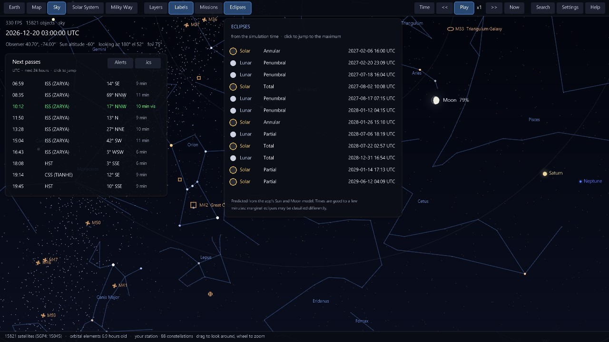

### Solar System

The planets and Pluto, Halley's comet, the asteroid belt, Jupiter's Trojans and the Kuiper belt, with time running up to 160 million times real speed.


### Spacecraft missions

Real trajectories for 37 missions, drawn on the Solar System view and on the globe: Voyager and Pioneer, Galileo, Cassini at Saturn, Rosetta, MESSENGER, New Horizons, Parker, Lucy, Europa Clipper, JUICE, BepiColombo and more, plus the Apollo 11 Saturn V, Artemis I and II, JWST and a modelled Starship test flight. Missions are grouped as completed, active and planned; select one to see its status, distance, light time and speed at the simulated time, its milestones (launch, flybys, arrivals), and use **Replay** to watch the whole flight or **Previous / Next** to jump between milestones. Press `V` for the mission list.

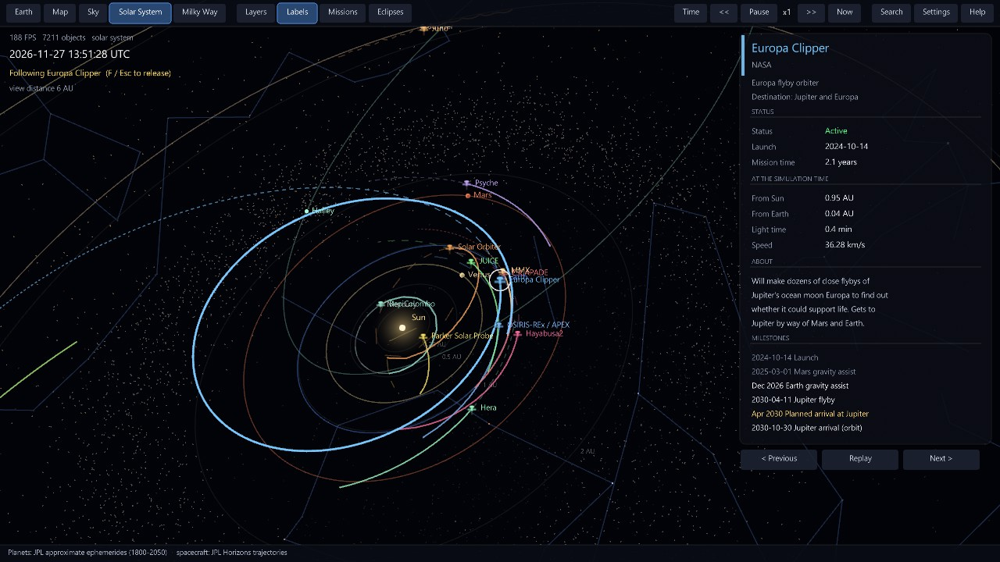

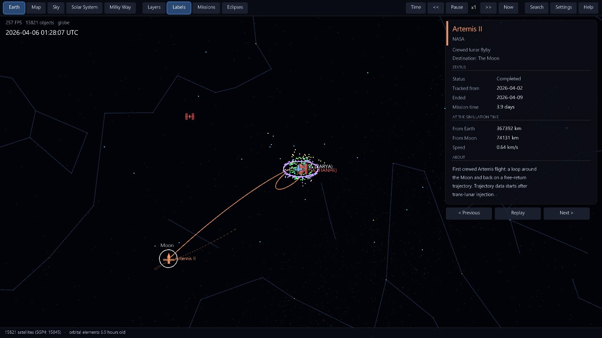

The Starship path is a modelled test-flight profile, not flight telemetry.

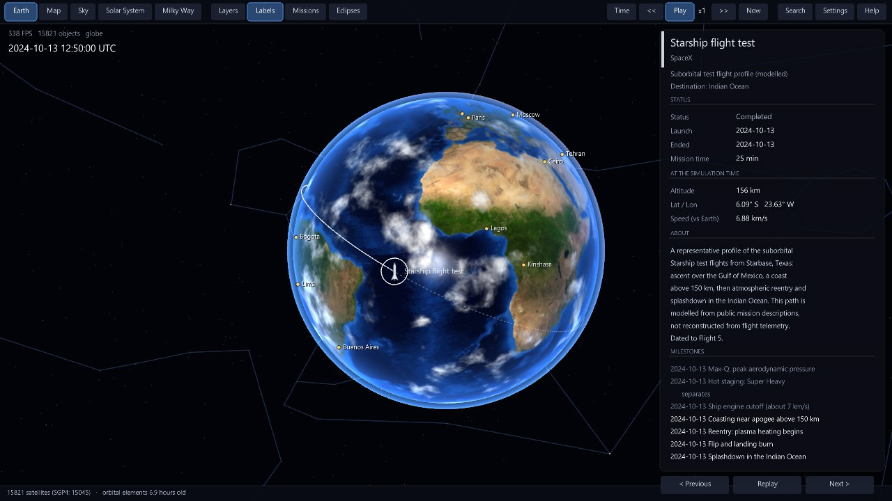

Paths come from NASA/JPL Horizons, so spacecraft line up with the planets they visit. Missions that have not launched appear only once JPL has published a predicted trajectory for them.

### Live layers

Earthquakes (USGS), wildfires, volcanoes and storms (NASA EONET), the aurora forecast with Kp index and solar X-ray flux (NOAA), upcoming rocket launches with countdowns and pads (Launch Library 2), and a decay watch for satellites in very low orbits. Available on the globe and the map.

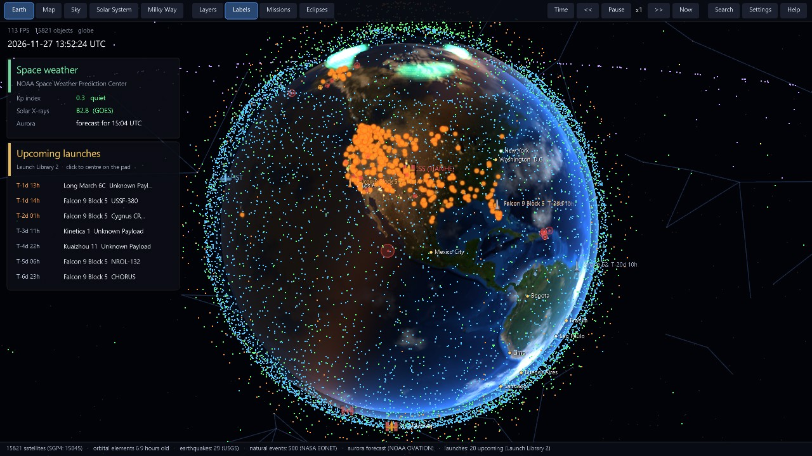

Follow a satellite and zoom in, and it becomes a 3D model.

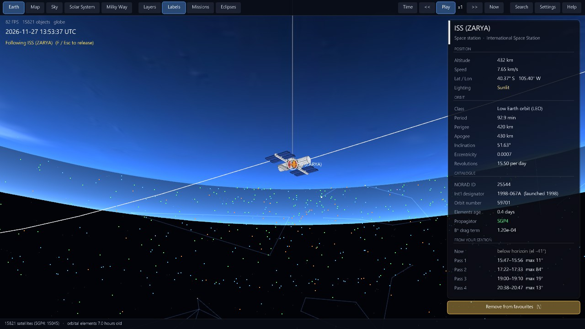

### Milky Way

A spiral galaxy with the Sun at its true position and 17,000 real stars, zoomable from megaparsecs down to the Sun's neighbourhood.

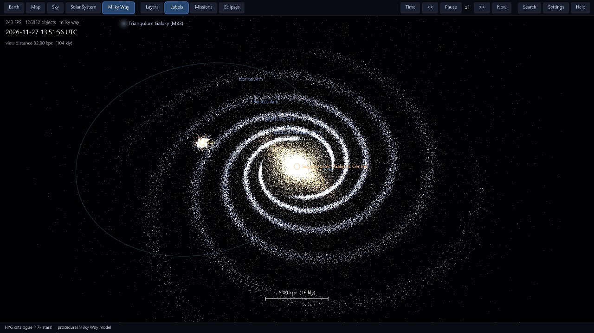

> Screenshots were captured with live data; aircraft, ships and weather change continuously.

---

## Features

- City names on the globe and map, thinning out as you zoom out; zooming the globe all the way in hands over to the street-level map, and zooming the map all the way out returns to the globe
- Satellite tracking with SGP4 orbit propagation, orbit lines, ground tracks, sunlit/shadow status and visible-pass prediction from your own location
- Satellite constellation filter plus per-group toggles in the Layers panel (Space Stations & crewed, Starlink, GNSS/Navigation, Weather & Earth observation, Comms, Geostationary)
- 3D models for the selected satellite, including the ISS, Tiangong, Hubble, JWST, Soyuz, cargo craft, Starlink, Iridium, GPS, weather and geostationary satellites, rocket bodies and debris
- Curated presets and highlights (`F10`) and an ambient auto-tour (`F11`) that cycles through iconic perspectives, including deep-sky objects and meteor shower radiants
- A "Learn more" card beside the info panel for any satellite, aircraft, ship or mission: a photo, a short Wikipedia summary, a details list (satellite owner, launch site, status, radio frequencies; aircraft owner and airline; ship builder, operator and tonnage) and links to CelesTrak, N2YO, Heavens-Above, FlightAware, Flightradar24, MarineTraffic and more. Aircraft also get their route with distance remaining and an estimated arrival. Results are cached on disk
- Live aircraft (ADS-B) with airline, aircraft type, registration country, climb state and emergency squawks
- Live ship traffic (AIS) with flag, type, destination, ETA and dimensions, plus a decoder for your own NMEA AIS feed
- Rain radar, GOES / Himawari cloud imagery, wind vectors and point weather
- Base maps: Blue Marble, OpenStreetMap (dark or standard) and NASA MODIS daily imagery
- Sky view with planets, the Moon with phase, constellations and twilight colours
- Solar System and Milky Way models with search, follow and scale bars
- Type-specific icons: airliners, regional props, business jets, light planes, helicopters and fighters by ICAO type; cargo, tanker, passenger, fishing, sailing and tug silhouettes; satellite icons by kind (station, telescope, navigation, weather, Starlink, crew vehicles). Drawn from vector shapes at start-up, so there are no image files
- 3D models of the ISS, Hubble, crew capsules and common satellite types when you follow or select one and zoom in (built in code, no model files)
- Spacecraft missions: past, active and planned, with real JPL trajectories, milestones and replay
- Live earthquakes, wildfires, volcanoes, storms, aurora forecast, space weather, rocket launches and a decay watch
- Pass planner with a 3 or 7 day window and minimum elevation, desktop notifications before visible passes, calendar (`.ics`) export, favourites and satellite group filters
- Sky view with 107 Messier deep-sky objects; eclipse predictions (`F9`); animated wind flow on the map; aircraft and ship history with a replay slider
- Jump to any date and time, run time forward or backward, metric / imperial / nautical units, saved settings

---

## Install

Download from the [Releases](../../releases) page:

| Platform | File |
|---|---|
| Windows | `SpaceMap-<version>-windows-x64-setup.exe` (installer) or `-portable.zip` |
| Debian / Ubuntu | `SpaceMap-<version>-linux-x64.deb` &mdash; `sudo apt install ./SpaceMap-<version>-linux-x64.deb` |
| Other Linux | `SpaceMap-<version>-linux-x64.tar.gz` |

Network features use the system `curl`. Settings and caches live next to the executable when that folder is writable, otherwise in `%LOCALAPPDATA%\SpaceMap` (Windows) or `~/.local/share/spacemap` (Linux).

---

## Controls

Drag to rotate, pan or look around; wheel to zoom; click an object for details; right-click to place your ground station. Press `F1` in the app for the full list.

| Key | Action |
|---|---|
| `Tab`, `E` `M` `S` `P` `W` | Switch view: Earth, Map, Sky, Solar System, Milky Way |
| `/` | Search |
| `A` `B` `D` `K` `Z` `X` `I` | Map layers: aircraft, ships, radar, clouds, wind, weather, city names |
| `F3` `F4` `F5` `F6` `F7` | Earthquakes, wildfires / volcanoes / storms, aurora and space weather, launches, decay watch |
| `V` | Spacecraft mission list |
| `\` `F8` | Favourite the selected satellite, pass alerts on / off |
| Space, `,` `.` `T` `N` `J` | Pause, speed, reverse, now, jump to a date |
| `F10` `F11` | Presets and highlights, ambient auto-tour |
| `F1` `F2` `F12` | Help, settings, screenshot |

---

## Build

Needs CMake 3.16+ and a C++17 compiler; raylib is downloaded automatically.

```bash
# Debian / Ubuntu
sudo apt install build-essential cmake git curl libgl1-mesa-dev libx11-dev \
  libxrandr-dev libxinerama-dev libxcursor-dev libxi-dev
cmake -S . -B build -DCMAKE_BUILD_TYPE=Release
cmake --build build -j
./build/spacemap
```

On Windows use MinGW-w64 or Visual Studio with the same `cmake` commands. Pushing a `v*` tag builds both platforms and publishes a release (see `.github/workflows/build.yml`).

---

## Data sources

Satellite elements: CelesTrak. Stars: HYG database. Constellations: Stellarium. Earth imagery, clouds and MODIS: NASA GIBS. Base map: OpenStreetMap contributors. Aircraft: adsb.lol and OpenSky Network. Ships: Digitraffic (set `ais_nmea=host:port` in `spacemap.cfg` to add your own AIS stream). Radar: RainViewer. Weather: Open-Meteo. Planet positions: JPL approximate elements, with high-precision JPL Horizons tracks for the outer planets (1970-2040). Spacecraft trajectories: NASA/JPL Horizons. Earthquakes: USGS. Natural events: NASA EONET. Space weather and aurora: NOAA SWPC. Launches: Launch Library 2 (The Space Devs).

Eclipse times come from the app's own Sun and Moon model and match published times to within minutes for recent eclipses. Aircraft and ship history is recorded locally while those layers are on, kept for three hours and saved in the data folder (`history_*.bin`).

Layers fetch data only while switched on, and only for the area in view.

### Updating spacecraft data

The trajectories in `assets/missions/` are generated from JPL Horizons and bundled, so the app works offline. To refresh them or add a mission (add a line to `MISSIONS` in the script and the app's mission table in `src/missions.hpp`):

```bash
python3 scripts/gen_missions.py            # everything
python3 scripts/gen_missions.py voyager1   # one mission
```

---

## License

MIT &mdash; see [LICENSE](LICENSE). Data sources and libraries keep their own licenses &mdash; see [THIRD_PARTY_NOTICES.md](THIRD_PARTY_NOTICES.md).
