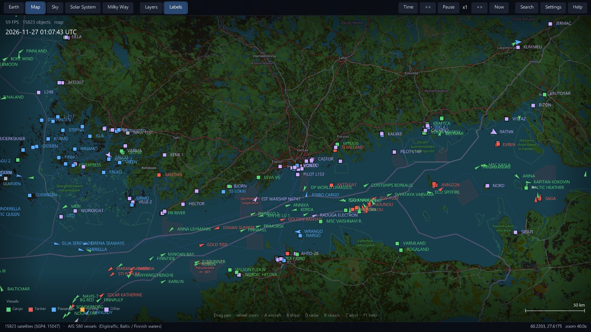
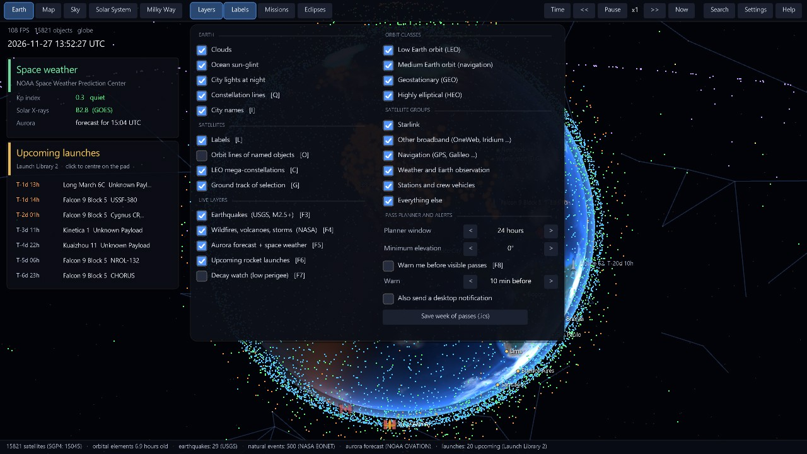
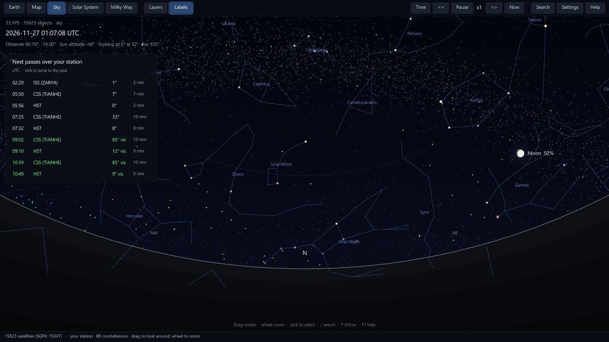
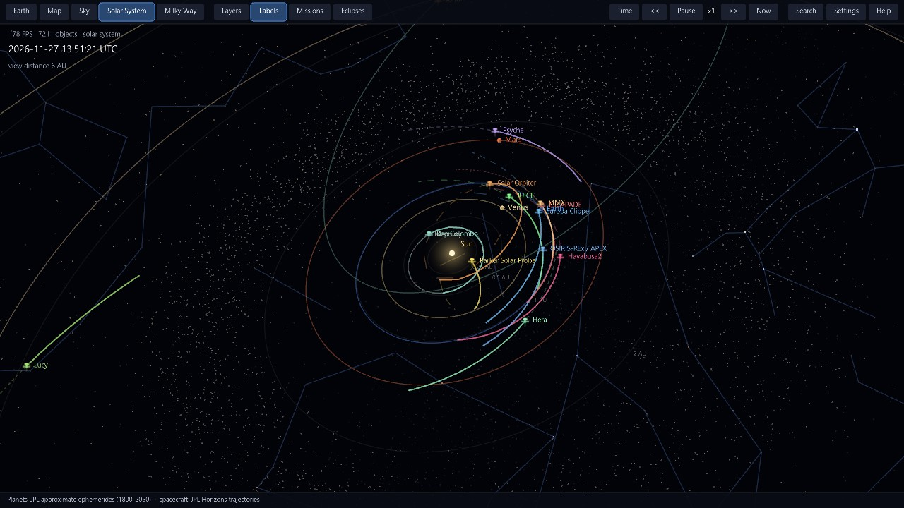

<p align="center"></p>

[](https://opensource.org/licenses/MIT)
[](../../releases)
[](../../actions/workflows/build.yml)

### Earth

About 15,800 satellites on a 3D globe: NASA imagery, drifting clouds, orbits, ground tracks and pass predictions, with full catalogue details for any object you click.


The night side glows with city lights.


### Live Map

Zoom to street level with live aircraft, rain radar, cloud imagery, wind and local weather.


Live ship traffic (Baltic and Finnish waters) over a dark base map.



Switch layers, base maps and filters from the toolbar.



### Sky

The sky from your ground station: real stars, 88 constellations, planets, the Moon's phase and every satellite above your horizon, with a pass planner for the ISS, Tiangong and Hubble.



### Solar System

The planets and Pluto, Halley's comet, the asteroid belt, Jupiter's Trojans and the Kuiper belt, with time running up to 160 million times real speed.



### Milky Way

A spiral galaxy with the Sun at its true position and 17,000 real stars, zoomable from megaparsecs down to the Sun's neighbourhood.


> Screenshots were captured with live data; aircraft, ships and weather change continuously.

---

## Features

- City names on the globe and map, thinning out as you zoom out; zooming the globe all the way in hands over to the street-level map, and zooming the map all the way out returns to the globe
- Satellite tracking with SGP4 orbit propagation, orbit lines, ground tracks, sunlit/shadow status and visible-pass prediction from your own location
- Live aircraft (ADS-B) with airline, aircraft type, registration country, climb state and emergency squawks
- Live ship traffic (AIS) with flag, type, destination, ETA and dimensions, plus a decoder for your own NMEA AIS feed
- Rain radar, GOES / Himawari cloud imagery, wind vectors and point weather
- Base maps: Blue Marble, OpenStreetMap (dark or standard) and NASA MODIS daily imagery
- Sky view with planets, the Moon with phase, constellations and twilight colours
- Solar System and Milky Way models with search, follow and scale bars
- Jump to any date and time, run time forward or backward, metric / imperial / nautical units, saved settings

---

## Install

Download from the [Releases](../../releases) page:

| Platform | File |
|---|---|
| Windows | `SpaceMap-<version>-windows-x64-setup.exe` (installer) or `-portable.zip` |
| Debian / Ubuntu | `SpaceMap-<version>-linux-x64.deb` &mdash; `sudo apt install ./SpaceMap-<version>-linux-x64.deb` |
| Other Linux | `SpaceMap-<version>-linux-x64.tar.gz` |

Network features use the system `curl`. Settings and caches live next to the executable when that folder is writable, otherwise in `%LOCALAPPDATA%\SpaceMap` (Windows) or `~/.local/share/spacemap` (Linux).

---

## Controls

Drag to rotate, pan or look around; wheel to zoom; click an object for details; right-click to place your ground station. Press `F1` in the app for the full list.

| Key | Action |
|---|---|
| `Tab`, `E` `M` `S` `P` `W` | Switch view: Earth, Map, Sky, Solar System, Milky Way |
| `/` | Search |
| `A` `B` `D` `K` `Z` `X` `I` | Map layers: aircraft, ships, radar, clouds, wind, weather, city names |
| Space, `,` `.` `T` `N` `J` | Pause, speed, reverse, now, jump to a date |
| `F1` `F2` `F12` | Help, settings, screenshot |

---

## Build

Needs CMake 3.16+ and a C++17 compiler; raylib is downloaded automatically.

```bash
# Debian / Ubuntu
sudo apt install build-essential cmake git curl libgl1-mesa-dev libx11-dev \
  libxrandr-dev libxinerama-dev libxcursor-dev libxi-dev
cmake -S . -B build -DCMAKE_BUILD_TYPE=Release
cmake --build build -j
./build/spacemap
```

On Windows use MinGW-w64 or Visual Studio with the same `cmake` commands. Pushing a `v*` tag builds both platforms and publishes a release (see `.github/workflows/build.yml`).

---

## Data sources

Satellite elements: CelesTrak. Stars: HYG database. Constellations: Stellarium. Earth imagery, clouds and MODIS: NASA GIBS. Base map: OpenStreetMap contributors. Aircraft: adsb.lol and OpenSky Network. Ships: Digitraffic (set `ais_nmea=host:port` in `spacemap.cfg` to add your own AIS stream). Radar: RainViewer. Weather: Open-Meteo. Planet positions: JPL approximate elements.

Layers fetch data only while switched on, and only for the area in view.

---

## License

MIT &mdash; see [LICENSE](LICENSE). Data sources and libraries keep their own licenses &mdash; see [THIRD_PARTY_NOTICES.md](THIRD_PARTY_NOTICES.md).
